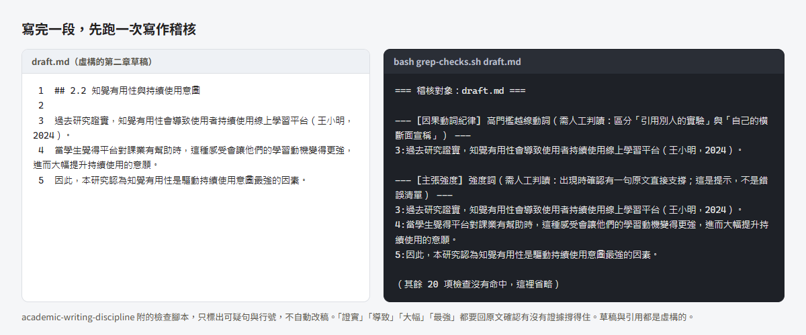

# 論文各階段用什麼：整合入口

> 這頁把本站和另外五個工具串成一條論文流程，從找題目到口試後修訂，每一站對到一頁說明、一個工具和一個要回原文核對的地方。先在第三節找到你卡住的那一列，照那一列做就好。每一站在網頁版和 Claude Code／Codex 兩條路線各用什麼，見[論文 AI 工作流全圖](ai-workflow-map.md)。

---

## 一、用 AI 寫論文常卡住的地方

- 引用對不上原文。AI 寫的句子看起來有出處，回 PDF 才發現作者沒這樣說，或把別的變項的數字套了上來。
- 文獻多到管不住。讀了三十篇，筆記散在好幾個地方，寫第二章時想不起那句話出自哪一篇。
- 不知道哪一步該用什麼。每個工具都說能幫你寫論文，很少有人說它該用在哪一步、用完哪裡要自己核對。
- 論文寫一兩年，每次開新對話都要把進度從頭講一遍。

## 二、這套流程做什麼

把論文分成五站，每站給你一頁說明和一個現成的工具，再標出 AI 給的東西要回哪份原文核對。找文獻、整理筆記、檢查邏輯和文字可以交給 AI，判斷和負責的人是你。

| 資源 | 做什麼用 | 說明網址 |
|---|---|---|
| mis-thesis-guide | 研究方法與論文寫作的知識庫，查觀念、查判準，也有提示詞範本 | <https://wayhong0928.github.io/mis-thesis-guide/> |
| mis-thesis-skills（內含 plugin `thesis-toolkit`） | 讓 Claude Code 照固定判準稽核研究題目與寫作，另有流程導覽 SKILL | <https://github.com/wayhong0928/mis-thesis-skills>，沒有獨立介紹網站 |
| thesis-notes-template | 下載就能用的 Obsidian 論文筆記庫：五種筆記模板、填寫規則、文獻矩陣、給 AI 的提示詞 | 介紹頁 <https://wayhong0928.github.io/thesis-notes-template/>，說明頁見[論文筆記庫範本](thesis-notes-template.md) |
| md-to-slides | 用 Markdown 寫簡報，挑場合和主題就有一份範例可以改 | <https://wayhong0928.github.io/md-to-slides/> |
| claude-workflow-template | Claude Code 的工作流程設定：接續進度、派工模板、獨立驗收。制度怎麼運作寫在它自己的網站，這裡不重寫 | <https://wayhong0928.github.io/claude-workflow-template/> |
| ai-agent-notes | Claude、Codex 這類 AI 代理工具的概念、設定和協作方式 | <https://wayhong0928.github.io/ai-agent-notes/> |

---

## 三、你卡在哪一站

<!-- family:flow:start -->
<link rel="stylesheet" href="../assets/family.css">

<a class="fam-guide" style="--i:0" href="https://wayhong0928.github.io/mis-thesis-guide/"><b>論文指南</b>每一站該怎麼做，都有一頁說明</a>
<ol class="fam-stages">
<li class="fam-stage" style="--i:1"><b>找題目</b><a class="fam-chip" href="https://github.com/wayhong0928/mis-thesis-skills">thesis-toolkit</a></li>
<li class="fam-stage" style="--i:2"><b>讀文獻</b><a class="fam-chip" href="https://wayhong0928.github.io/thesis-notes-template/">論文筆記庫範本</a></li>
<li class="fam-stage" style="--i:3"><b>設計與分析</b><a class="fam-chip" href="https://wayhong0928.github.io/thesis-notes-template/">論文筆記庫範本</a></li>
<li class="fam-stage" style="--i:4"><b>寫論文</b><a class="fam-chip" href="https://github.com/wayhong0928/mis-thesis-skills">thesis-toolkit</a></li>
<li class="fam-stage" style="--i:5"><b>口試與修訂</b><a class="fam-chip" href="https://wayhong0928.github.io/md-to-slides/">md-to-slides</a></li>
</ol>

<b>每一站都用得到的 AI 工作環境</b><a class="fam-chip" href="https://wayhong0928.github.io/claude-workflow-template/">Claude Code 工作流 template</a><a class="fam-chip" href="https://wayhong0928.github.io/ai-agent-notes/">AI Agent 筆記</a>

<!-- family:flow:end -->

| 卡住的時候 | 先看 | 用這個工具 | 回原文核對 |
|---|---|---|---|
| 碩一下，老師說題目自己想 | [從零開始](getting-started.md)第二節、第九節；[研究問題、假說與研究架構](problem-design.md) | thesis-toolkit 的 `research-direction-finding`、`research-question-audit` | AI 提的方向要能指到真實存在的文獻，帶著那幾篇去跟指導教授談 |
| 讀了三十篇，文獻探討還是寫不出來 | [論文筆記庫範本](thesis-notes-template.md)、[接上 Zotero 與 Obsidian](ai-zotero-obsidian.md)、[學術倫理與 AI 揭露](ethics.md) | 論文筆記庫範本 | 數字、頁碼、構念名稱回 PDF 逐項打勾 |
| 要發問卷，量表要改編 | [問卷調查法](method-survey.md) 2.1、4.2 | 論文筆記庫範本的 `07_模板/06_方法.md` | 操作型定義和量表題項回原始論文核對，不用 AI 轉述的版本 |
| 統計跑完看不懂，或老師說數字不對 | [問卷調查法](method-survey.md) 3.3、6.3；[量化分析規劃與資料處理基礎](quant-analysis-basics.md) | 無 | AI 對結果的解讀，回你自己的輸出表逐項對 |
| 用 AI 寫了一段，老師說引用對不上 | [論文 AI 工作流全圖](ai-workflow-map.md)、[實例](ai-case-study.md)第四節、[學術倫理與 AI 揭露](ethics.md)第四節 | thesis-toolkit 的 `academic-writing-discipline` | 每個引用回原文確認作者真的這樣說 |
| 下個月口試 | [計畫書、口試與簡報](defense.md) | md-to-slides | 質詢清單的每一題都要能指回論文或文獻裡的位置 |
| 口試完拿到一堆修改意見 | [口試後修訂、典藏與結案](post-defense.md) | 無 | 修訂時改寫過的句子，引用要再回原文對一次 |

不確定自己在哪一站，可以直接對 Claude Code 說「我論文卡住了，不知道下一步」，thesis-toolkit 的 `thesis-roadmap` 會判斷階段並指出下一步。

### 只裝其中一個

| 工具 | 怎麼裝 |
|---|---|
| thesis-toolkit | 在 Claude Code 輸入 `/plugin marketplace add wayhong0928/mis-thesis-skills`，再輸入 `/plugin install thesis-toolkit@mis-thesis-skills`。網頁版和 Codex 的裝法見該 repo 的 README |
| 論文筆記庫範本 | 從 GitHub 下載 ZIP 解壓縮，用 Obsidian 打開。有 Claude Code 或 Codex 的話，把範本 `00_總覽/prompt.md` 第 0 段貼給它，它會連 Zotero 一起裝 |
| md-to-slides | 在網站選場合和主題，下載起手包，用 VS Code 打開 |
| claude-workflow-template | 照它網站上的安裝步驟 |

想一次全部裝好，用[整套安裝](ai-full-install.md)那段 prompt。

### 每一步的細項

骨架是 thesis-toolkit 的 `thesis-roadmap` 判斷的三個階段（找方向、稽核題目、稽核寫法），再加上它列為「thesis-toolkit 不管」的幾項。第 4、5、9 列在 `thesis-roadmap` 沒有對應的 SKILL，這裡依本站的頁面和筆記庫範本補上可用的資源，補上的部分不屬於 thesis-toolkit。

節號有兩套。「提示詞範本」指[AI 提示詞範本](prompts.md)的節；「範本 6.x」指[論文筆記庫範本](thesis-notes-template.md)第六節的小節。

| # | 階段 | thesis-toolkit 的 SKILL | 提示詞 | 筆記庫範本 | 本站頁面 | 回原文核對 |
|---|---|---|---|---|---|---|
| 1 | 找方向 | `research-direction-finding` | [提示詞範本](prompts.md) 10.1、1.1 | 無 | [從零開始](getting-started.md)第九節 | AI 提的方向要能指到真實存在的文獻，帶著那幾篇去跟指導教授談 |
| 2 | 稽核題目 | `research-question-audit` | [提示詞範本](prompts.md) 10.2、4.1、4.3、1.3 | `00_總覽/研究設計速查.md` | [研究問題、假說與研究架構](problem-design.md) | 缺口寫成「在這幾篇裡沒看到」，再到資料庫搜一次 |
| 3 | 找文獻 | 無 | [提示詞範本](prompts.md) 2.1、2.2、3.1 | 無 | [怎麼找、怎麼讀、怎麼選題目](finding-reading.md)、[AI 學術研究工具指南](tool-directory.md) | 每篇先確認文獻存在，再下載原文；搜尋工具給的摘要不能當原文引用 |
| 4 | 讀文獻與寫筆記（補） | 無 | [提示詞範本](prompts.md) 3.2、3.4；範本 6.1 到 6.3 | 三種文獻筆記模板、`文獻筆記填寫規則.md`、`prompt.md`、`文獻矩陣.base` | [文獻回顧與批判性思考](literature.md)、[文獻管理與知識庫](tools-knowledge.md)、[論文筆記庫範本](thesis-notes-template.md) | 數字、頁碼、構念名稱回 PDF 逐項打勾；範本 6.3 的核對要開新對話 |
| 5 | 構念整理與假說推演（補） | 無 | 範本 6.4 收料進構念卡、範本 6.5 推演卡健檢 | `07_模板/02_變數.md`、`07_模板/05_假設推演.md` | [論文筆記庫範本](thesis-notes-template.md)第六節、[研究問題、假說與研究架構](problem-design.md) | 隨機點幾個 `[[citekey]]` 回筆記，看那句話是不是真的在裡面 |
| 6 | 選方法、設計問卷 | 無 | [提示詞範本](prompts.md) 5.1、5.2 | `07_模板/06_方法.md` | [方法論選擇地圖](methodology.md)、[問卷調查法](method-survey.md) | 操作型定義和量表題項回原始論文核對，不用 AI 轉述的版本 |
| 7 | 統計分析 | 無 | [提示詞範本](prompts.md) 5.3 | 無 | [量化分析規劃與資料處理基礎](quant-analysis-basics.md) | AI 對結果的解讀，回你自己的輸出表逐項對 |
| 8 | 寫章節 | `academic-writing-discipline` | [提示詞範本](prompts.md) 10.3、6.1、6.2 | `04_論文草稿`（只有說明檔） | [論文架構與各章寫作要領](writing.md)、[學術中文寫作紀律](style.md) | 橫斷面資料不寫「導致」這類動詞；每個引用回原文確認作者真的這樣說 |
| 9 | 計畫書、口試、簡報（補） | `research-question-audit` 的對抗式審查 | [提示詞範本](prompts.md) 6.3、6.4 | 無 | [計畫書、口試與簡報](defense.md)、[學術倫理與 AI 揭露](ethics.md) | AI 揭露照系所和指導教授的規定寫；質詢清單的每一題都要能指回論文或文獻裡的位置 |
| 跨 | 長專案接力、派工、獨立驗收 | 無 | 無 | 無 | 只連 [claude-workflow-template 介紹頁](https://wayhong0928.github.io/claude-workflow-template/)，這裡不重寫 | 做的人不驗自己的活，細節見該站 |

`thesis-roadmap` 只管前面三個稽核 SKILL 對應的階段，其餘的看上面這張表。

### 第 4 列的閱讀追蹤

筆記範本的每份文獻筆記，frontmatter 都有 `status` 欄（🌱 剛建立、🌿 充實中、🌳 可直接寫進論文），`文獻矩陣.base` 把它顯示成「狀態」欄。所以讀文獻時可以這樣追蹤進度：

1. 建筆記時先標 🌱，讀完全文、筆記能撐起論文某一句話時才改成 🌳。
2. 在 `文獻矩陣.base` 依狀態排序，看哪些還沒讀完。
3. 下一篇讀哪篇，從已讀筆記的第九節「值得追讀的參考文獻」挑，回原文核對過就填 `verified` 日期（這是建議做法）。

前兩點是範本本來就有的欄位和表格。第 3 點是站主的建議，範本沒有把它寫成固定流程。

---

## 四、核對抓得到什麼錯

下面兩個例子的草稿句都是為了示範寫的，不是哪一篇真實論文的內容。

**引用的方向寫反。** 假設你請 AI 依筆記寫一句文獻回顧，它寫出「Davis（1989）發現，知覺易用性和使用的相關高於知覺有用性」。這句讀起來很順。回到筆記庫範本附的示範筆記 `03_文獻筆記/Davis1989.md`，一句話結論寫的是知覺有用性和使用的相關（.63、.85）高於知覺易用性（.45、.59），出處是原文第 2 頁，AI 的句子剛好寫反。只看草稿抓不到這種錯，要回筆記和 PDF 才看得出來。

**主張寫得比證據強。** 一段虛構的第二章草稿，交給 thesis-toolkit 的 `academic-writing-discipline` 附的檢查腳本跑一次，結果如下。腳本只標出可疑句和行號，不會自動改稿；「證實」「導致」「大幅」「最強」這幾個詞，要回原文確認有沒有證據撐得住。

<figure class="fam fam-shot">

<figcaption>字太小的話，點圖看原尺寸。</figcaption>
</figure>

站主自己寫論文時，回原文核對抓到的錯列在[實例](ai-case-study.md)第四節。

---

## 五、限制：哪些事不能交給 AI

這套流程能幫你找文獻、整理筆記、核對數字、檢查邏輯和文字，但每篇要寫進論文的文獻，最好自己讀過。AI 寫的筆記照樣會漏東西，也會把原文沒有的話寫進去；你沒讀過原文，就看不出哪裡漏了、哪裡錯了。論文裡每一句話由你負責，口試時被問到的也是你。

第三節每一列的「回原文核對」，意思是 AI 給的東西要回 PDF 或原始資料對過才算數。統計判準與格式慣例依領域和系所而不同，以系所規定和指導教授意見為準。學術倫理與 AI 揭露怎麼寫，見[學術倫理與 AI 揭露](ethics.md)。

---

## 六、兩個附加頁

- [用 Claude Code＋Zotero＋Obsidian 管理文獻與文獻筆記](ai-zotero-obsidian.md)：這套筆記庫怎麼接上 Zotero 和 Claude Code，從裝工具到寫筆記、核對、收料的順序，每一步指到範本和各 README 原本的段落。
- [整套安裝：一段 prompt 裝好論文工作環境](ai-full-install.md)：一段貼給你自己的 AI 的安裝 prompt，把筆記庫範本、Zotero、Obsidian 和 thesis-toolkit 裝好，Claude Code 的工作流程設定接到它自己的網站。

---

## 七、怎麼取得新版

| 資源 | 更新方式 |
|---|---|
| 本站 | 沒有訂閱機制，各頁改了什麼寫在[關於本站](about.md)的更新紀錄，需要時回來看 |
| thesis-toolkit | 在終端機跑 `claude plugin marketplace update mis-thesis-skills` 和 `claude plugin update thesis-toolkit@mis-thesis-skills`；或在 Claude Code 輸入 `/plugin`，到 Marketplaces 分頁選 `mis-thesis-skills`，開啟 Enable auto-update。更新後開新 session，或在正在用的 session 輸入 `/reload-plugins`。Codex 是把 SKILL 資料夾複製到 `.agents/skills/` 或建 symlink，複製的要下載新版再複製一次，symlink 的更新它指向的那份就好。各版改了什麼見該 repo 的 [CHANGELOG](https://github.com/wayhong0928/mis-thesis-skills/blob/main/plugins/thesis-toolkit/CHANGELOG.md) |
| thesis-notes-template | 只換 `07_模板/`、`00_總覽/文獻筆記填寫規則.md`、`00_總覽/prompt.md`。`00_總覽/術語表.md` 和 `00_總覽/研究設計速查.md` 是你填過的，不要覆蓋；`01_理論` 到 `06_方法` 放的是你的筆記，也不要動。不要把整包新版蓋過去 |
| claude-workflow-template | 照它 README 寫的更新方式 |

換 `07_模板/` 之前，如果你自己改過模板，先把改過的檔案另存一份再換，換完再把想留的改動補回去。舊筆記不用重寫，缺的欄位照新模板補上就好。
